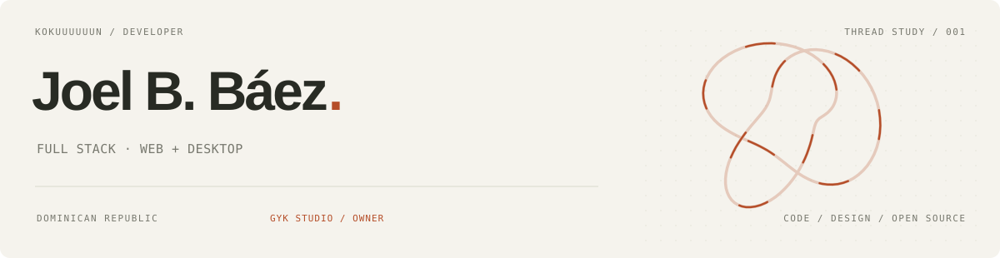

<picture>
  <source media="(prefers-color-scheme: dark)" srcset="./assets/profile-cover.svg" />
  
</picture>

  <samp>
    <a href="https://joeldev-portafolio.netlify.app/">portfolio ↗</a> &nbsp; / &nbsp;
    <a href="./portfolio">portfolio source ↗</a> &nbsp; / &nbsp;
    <a href="https://github.com/GYK-Studio">GYK Studio ↗</a> &nbsp; / &nbsp;
    <a href="mailto:joelbonillabaez@gmail.com">email ↗</a>
  </samp>

I'm **Joel**, a full stack developer from the Dominican Republic and an owner of **[GYK Studio](https://github.com/GYK-Studio)** and its Discord community. I work on web and desktop apps, with an interest in AI, design, and 3D.

### On my workbench

| Project | Notes |
| :--- | :--- |
| **[Crochet ↗](https://github.com/Kokuuuuuun/crochet)** | Offline crochet app: pattern editor, row counters, and yarn inventory. TypeScript · Next.js · Electron · SQLite |
| **[Mihon Desktop ↗](https://github.com/Kokuuuuuun/Mihon-desktop)** | My Linux desktop fork of [Mihon](https://github.com/mihonapp/mihon), with an embedded Suwayomi server. Kotlin · Compose Multiplatform |

  
Open the full project index — 15 repositories & collaborations

| Personal repositories | |
| :--- | :--- |
| [Crochet](https://github.com/Kokuuuuuun/crochet) | Offline crochet workspace |
| [Nuvio Latino Hub Providers](https://github.com/Kokuuuuuun/Nuvio-Latino-Hub-Providers) | Spanish-language providers for Nuvio |
| [Zoodom Solicitudes](https://github.com/Kokuuuuuun/zoodom_solicitudes) | Request-management project in PHP |
| [The Oasis](https://github.com/Kokuuuuuun/The-Oasis) | An early beverage shop project |
| [Portfolio](https://github.com/Kokuuuuuun/Portafolio) | My earlier portfolio |
| [Kokuuuuuun](https://github.com/Kokuuuuuun/kokuuuuuun) | This profile & standalone Astro portfolio |

| Forks | |
| :--- | :--- |
| [Mihon Desktop](https://github.com/Kokuuuuuun/Mihon-desktop) | Mihon adapted for the desktop |
| [Moku](https://github.com/Kokuuuuuun/Moku) | Manga, novel, and anime reader |
| [Serversito](https://github.com/Kokuuuuuun/serversito) | Python Minecraft server utility |
| [Vimeus Stremio Add-on](https://github.com/Kokuuuuuun/vimeus_stremio_addon) | Stremio API integration |

| Shared work | Relationship |
| :--- | :--- |
| [Elysium](https://github.com/Elysium-Proyecto/Elysium) | Collaborative academic platform |
| [Self-host M](https://github.com/GYK-Studio/self-host-M) | GYK Studio · self-hosted backend |
| [NuvioWeb](https://github.com/GYK-Studio/NuvioWeb) | GYK Studio · website fork |
| [GYK Studio Website](https://github.com/GYK-Studio/Website) | GYK Studio · Astro website |
| [GYK Studio Profile](https://github.com/GYK-Studio/.github) | GYK Studio · organization profile |

### Languages

  

<samp>TypeScript · JavaScript · Kotlin · Python · Rust · Go · Java · PHP</samp>

### Across the stack

| Layer | Technologies |
| :--- | :--- |
| **Frontend** | React · Next.js · Svelte · Astro · HTML · CSS / SCSS · Tailwind |
| **Backend** | Node.js · Express · Django |
| **Databases & cache** | MySQL · MongoDB · SQLite · Redis |
| **Desktop** | Electron · Compose Multiplatform · Tauri |
| **Cloud & delivery** | AWS · Docker · Vercel · Netlify |
| **Developer tools** | Git · GitHub · Postman · npm / pnpm |
| **Design & 3D** | Figma · Blender |

  
UI libraries & build tools

Radix UI · shadcn/ui · React Hook Form · Zod · Lucide · Recharts · GSAP · PostCSS · Autoprefixer · Electron Builder

### Studio & contact

**GYK Studio — Owner.** My organization and Discord community. [Explore the studio's repositories ↗](https://github.com/orgs/GYK-Studio/repositories)

Have a project or a question? [joelbonillabaez@gmail.com](mailto:joelbonillabaez@gmail.com)

---

<samp>joel b. báez / kokuuuuuun · web, desktop & open source</samp>
