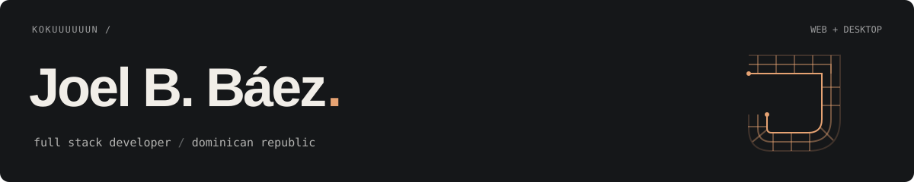

  <samp>
    <a href="https://joeldev-portafolio.netlify.app/">portfolio ↗</a> &nbsp; / &nbsp;
    <a href="https://github.com/Kokuuuuuun?tab=repositories">code ↗</a> &nbsp; / &nbsp;
    <a href="https://github.com/Kokuuuuuun?tab=stars">bookmarks ↗</a>
  </samp>

I'm Joel, a full stack developer from the Dominican Republic. I work on web and desktop apps, and spend time with AI, design, and 3D too.

### Selected projects

<table>
  <tr>
    <td width="50%" valign="top">
      01 / DESKTOP APP
      <h3><a href="https://github.com/Kokuuuuuun/crochet">Crochet ↗</a></h3>
      
An offline crochet app with a visual pattern editor, row counters, yarn inventory, and local storage.

      
<samp>TypeScript · Next.js · Electron · SQLite</samp>

    </td>
    <td width="50%" valign="top">
      02 / OPEN SOURCE FORK
      <h3><a href="https://github.com/Kokuuuuuun/Mihon-desktop">Mihon Desktop ↗</a></h3>
      
My desktop fork of <a href="https://github.com/mihonapp/mihon">Mihon</a>. A manga reader for Linux using Compose Multiplatform and an embedded Suwayomi server.

      
<samp>Kotlin · Compose Multiplatform · Linux</samp>

    </td>
  </tr>
</table>

### Stack

  

| Area | Technologies |
| :--- | :--- |
| **Frontend** | React, Next.js, Svelte, Astro, Tailwind, HTML, CSS, SCSS |
| **Backend** | Node.js, Express, Django |
| **Data** | MySQL, MongoDB, SQLite, Redis |
| **Cloud & tools** | AWS, Docker, Git, GitHub, Postman, Vercel, Netlify |
| **Desktop & design** | Electron, Compose Multiplatform, Figma, Blender |

  
More tools & libraries

   
  Radix UI, shadcn/ui, React Hook Form, Zod, Lucide, Recharts, npm, PostCSS, Autoprefixer, Electron Builder.

 

<samp>kokuuuuuun / <a href="https://joeldev-portafolio.netlify.app/">elsewhere on the web ↗</a></samp>
